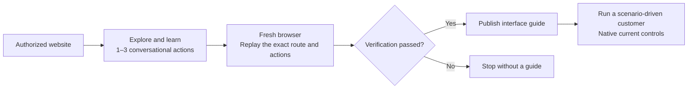
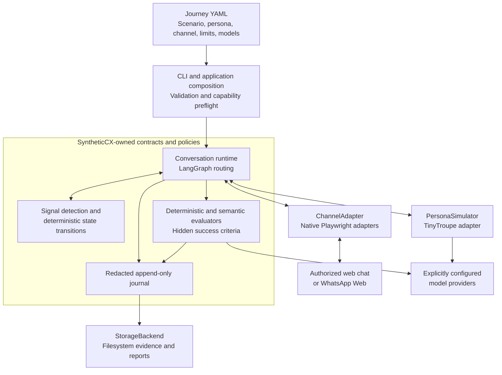
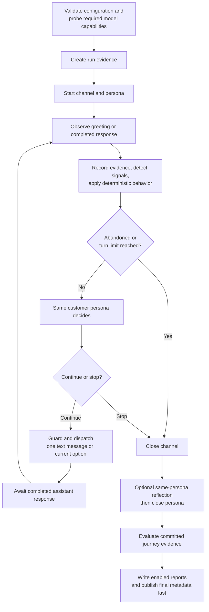

# SyntheticCX

> **Simulate customers. Test journeys. Understand failures.**

SyntheticCX is an open-source Python framework for testing conversational customer journeys through the **actual customer-facing interface**. Give a synthetic customer a goal and a personality, let it interact through a browser, and evaluate what happened—with conversation evidence, behavioral transitions, and explainable findings.

Instead of asserting an exact chatbot response, ask: **could this customer achieve their goal, and what prevented them if they could not?**

**Version:** 0.1.0 · **Status:** pre-alpha · **Python:** 3.11–3.13 · **License:** [Apache-2.0](LICENSE)

## Why SyntheticCX?

- **Test the whole journey.** Exercise the chat UI, menus, conversation, and response handling—not just a model endpoint.
- **Separate the goal from the customer.** Reuse a scenario with different personas, writing styles, and patience levels.
- **Observe behavior, not just replies.** Apply deterministic frustration and abandonment rules with auditable state changes.
- **Judge outcomes with evidence.** Combine deterministic checks and semantic goal evaluation; keep hidden success criteria outside the persona's input.
- **Keep the evidence.** Save redacted configuration, messages, an append-only trace, evaluation results, and optional Markdown reports locally.
- **Extend explicit boundaries.** Supply trusted custom evaluators and behavioral detectors in Python without importing code from YAML.

| Channel | Status | Interaction surface |
| --- | --- | --- |
| Web chat | Primary channel | Inspectable text chats and assistant-owned menu options through Playwright |
| WhatsApp Web | Experimental | Website handoff, dedicated authenticated profile, text, reply buttons, and supported list menus |

> **Use authorized targets and synthetic data.** SyntheticCX is not a general-purpose browser agent. It does not guarantee compatibility with every chat widget, and simulated results are not measurements of a real customer population.

## Contents

- [Get started](#get-started)
- [Inspect the results](#inspect-the-results)
- [Configure a journey](#configure-a-journey)
- [Discover a web-chat channel](#discover-a-web-chat-channel)
- [WhatsApp Web](#whatsapp-web-experimental)
- [Architecture](#architecture)
- [Extend the framework](#extend-the-framework)
- [Replay behavior offline](#replay-behavior-offline)
- [Safety and limitations](#safety-and-limitations)
- [Troubleshooting](#troubleshooting)
- [Development](#development)

## Get started

### Prerequisites

- [Git](https://git-scm.com/) and [uv](https://docs.astral.sh/uv/getting-started/installation/).
- Python 3.11–3.13. The commands below select Python 3.11; uv can provision it if needed.
- A model credential. The bundled example uses OpenAI's `gpt-5.4-mini`.

The commands below use Bash/zsh syntax and run from a source checkout. Linux is the CI target; macOS has also been exercised locally. Windows compatibility is not verified.

### 1. Clone and install

```bash
git clone https://github.com/andermenezes/synthetic-cx.git
cd synthetic-cx
uv sync --locked --group dev --python 3.11
uv run --no-sync playwright install chromium
```

On Linux, use this browser-install command instead to include system dependencies:

```bash
uv run --no-sync playwright install --with-deps chromium
```

The committed `uv.lock` pins the development environment. Install Chromium through that environment so its version matches Playwright.

### 2. Set your model credential

```bash
export OPENAI_API_KEY='your-api-key'
```

Credentials are read from the environment, not journey YAML. Export the variable in the terminal where you run SyntheticCX; merely creating a `.env` file is not a substitute for exporting it.

> **The demo makes real model API calls and may incur charges.** Only the target web chat is local. A compatible alternative endpoint can be explicitly configured under [Model providers](#model-providers).

### 3. Run a local customer journey

```bash
uv run --no-sync python examples/telecom/run_demo.py --variant success --persona standard
```

This starts a controlled telecom chat on an available loopback port, runs a synthetic customer who wants to understand a higher bill, evaluates the conversation, and saves evidence under `.runs/`. The launcher manages the fixture's lifetime and does not modify the [canonical scenario](examples/telecom/scenario.yaml).

Try the same journey with an impatient customer and a chat that repeats an account-number request:

```bash
uv run --no-sync python examples/telecom/run_demo.py \
  --variant repeated_question --persona impatient
```

The fixture variants provide contrasting experiences, **not guaranteed model verdicts**. Customer messages and semantic evaluations can vary. An evaluation-failure exit code is a test result, not necessarily a broken installation.

### 4. Find the report

The CLI prints the run ID and evidence directory. Open `report.json` for the outcome and findings, then follow its evidence references into `trace.jsonl`.

You have now exercised the real browser, persona, evaluation, and storage path. To use your own target, continue with [channel discovery](#discover-a-web-chat-channel).

## Inspect the results

Each acknowledged run gets a new directory; earlier runs are not overwritten:

```text
.runs/run-<id>/
├── metadata.json       # Lifecycle, termination, model metadata, artifact inventory
├── config.yaml         # Effective redacted configuration and source hashes
├── conversation.json   # Ordered customer and assistant messages
├── trace.jsonl         # Authoritative append-only evidence
├── evaluation.json     # Criteria and evaluator findings
├── report.json         # Summary, metrics, findings, and evidence references
├── report.md           # Optional Markdown report
└── artifacts/          # Optional local telemetry and permitted captures
```

JSON projections can be disabled through storage settings. A failure can leave partial evidence rather than a finalized report; the CLI distinguishes those cases. Redacted `config.yaml` is an evidence snapshot, not a credential source.

**Termination and outcome are different.** The persona may stop because it believes the goal is complete, abandons, or reaches a limit. Independent evaluators determine whether the recorded conversation satisfies the required criteria.

### CLI and exit codes

```bash
uv run --no-sync synthetic-cx run path/to/scenario.yaml
uv run --no-sync synthetic-cx run path/to/scenario.yaml --headed --language pt-BR
uv run --no-sync synthetic-cx --help
uv run --no-sync synthetic-cx discover --help
```

Runs are headless by default. `--headed` needs a desktop display. Supported customer languages are `en-US` and `pt-BR`; language settings guide generation but cannot guarantee perfect model compliance.

| Exit | Meaning |
| ---: | --- |
| `0` | All required evaluation criteria passed |
| `1` | One or more required criteria failed |
| `2` | Configuration or capability-preflight error; no browser journey created |
| `3` | Channel, model, evaluator, storage, or other infrastructure failure |
| `130` | User interruption after bounded cleanup |

Infrastructure failures take precedence over evaluation results. A journey timeout returns `3`. A storage shutdown failure also returns `3`; if a report was already finalized, it is preserved and the CLI separately reports the later shutdown failure. Supplemental telemetry failure does not change the journey verdict.

### Customer impressions and Markdown reports

Merge this fragment into a complete journey to request feedback from the **same simulated customer** after the conversation:

```yaml
scenario:
  # Retain the existing scenario fields and success_criteria.
  observation_topics:
    - id: clarity
      description: Was the billing explanation understandable?
    - id: usability
      description: What felt easy, confusing, or frustrating?

reporting:
  language: en-US
  markdown:
    enabled: true
```

Topics enable one bounded reflection even when Markdown is disabled. They are not shown while the persona is chatting; hidden success criteria and evaluator verdicts are not provided to reflection. Feedback never adds a customer turn or determines pass/fail. Unavailable reflection is reported explicitly, not interpreted as dissatisfaction.

`report.md` separates customer impressions, formal findings, and source conversation evidence. It is rendered without another report-generation model call and works independently of the JSON-report flag. These impressions are subjective, not formal usability measurements. Configure at most 10 unique topics; descriptions must be nonblank and at most 2,000 characters.

## Configure a journey

Start from [`examples/telecom/scenario.yaml`](examples/telecom/scenario.yaml), not an incomplete snippet. Its fixed URL is illustrative; the demo launcher replaces it with the running fixture's actual port.

| Section | Responsibility |
| --- | --- |
| `scenario` | Customer goal, starting context, allowed knowledge, and hidden success criteria |
| `persona` | Identity, communication preferences, initial state, and behavioral rules |
| `channel` or `channel_guide` | Inline interface configuration or a relative local guide path; mutually exclusive |
| `execution` | Customer-turn limit, journey deadline, and bounded operation timeouts |
| `model` | Persona model and explicit credential source |
| `evaluation_model` | Optional separate semantic-evaluation model; defaults to `model` |
| `behavior` | Optional selection of registered signal detectors |
| `reporting`, `storage`, `privacy`, `telemetry` | Feedback, artifact retention, redaction, and observability |

Unknown fields and invalid limits are rejected. Do not add document-version or detector-implementation-version fields to journey YAML. Generated contracts are in [`schemas/`](schemas/), including the [journey schema](schemas/project.schema.json) and [discovery-draft schema](schemas/discovery-draft.schema.json).

### Personas and deterministic behavior

A persona separates **who the customer is**, **how they write**, and **how their owned state evolves**. For example, replace the persona section in a complete journey with:

```yaml
persona:
  id: impatient-customer
  name: Alex
  description: A busy subscriber with limited technical knowledge.
  behavior_description: Requests practical explanations and dislikes repetition.
  communication:
    language: en-US
    tone: polite
    style: concise
    message_length: short
    writing_description: Asks one concrete question at a time.
  initial_state:
    frustration: 0.1
    willingness_to_continue: 0.6
  behavioral_rules:
    - id: repetition-frustration
      priority: 10
      when:
        signal: repeated_information
      effects:
        frustration_delta: 0.2
        willingness_to_continue_delta: -0.2
        abandonment_threshold: 0.1
```

Narratives and writing preferences guide the model; they cannot override scenario facts, action permissions, structured settings, or owned state. `message_length` accepts `short`, `medium`, or `long` as soft preferences. Typo, spelling-error, and grammar-error probabilities are generation tendencies, not measured human error rates or post-generation text transformations.

The default detectors emit `repeated_information` and `customer_turn_completed`. A completed-turn signal requires both a successful customer action and a completed response; greetings and supplemental replies do not count. Option selections count as customer turns but not as typed account information.

Rules support occurrence thresholds, inclusive state bounds (`gte`/`lte`), and `fire: once` or `every_match`. Matching rules use the same pre-signal state, sort by priority then ID, sum deltas, and clamp state to `[0,1]`. Abandonment is terminal. An explicit `behavior.detectors` list selects exactly those detectors; an empty list requires no signal-dependent rules. Obsolete `event`/top-level-delta rule shapes must be rewritten as `when`/`effects`.

### Evaluators

| Built-in evaluator | Result | Parameters |
| --- | --- | --- |
| `semantic_goal_completion` | Boolean or scored | `expected_facts`; scored criteria also require `threshold` |
| `repeated_information` | Boolean | `max_repeats` (default `0`) |
| `turn_count` | Boolean | `max_turns` |
| `journey_timeout` | Boolean | None |

Required criteria gate the outcome; optional criteria remain diagnostic. Evidence policies are `required`, `optional`, or `none`. Semantic goal findings cite current-run assistant messages: an offered menu, delivery tick, or customer belief is not proof of business success. [Custom evaluators](#trusted-custom-evaluators) use the same result and citation checks.

### Model providers

The bundled configuration uses:

```yaml
model:
  provider: openai
  model: gpt-5.4-mini
  credential_environment_variable: OPENAI_API_KEY
```

For an explicitly configured OpenAI-compatible endpoint, replace that section, for example:

```yaml
model:
  provider: openai_compatible
  model: your-model-name
  base_url: http://127.0.0.1:8001/v1
  credential_environment_variable: LOCAL_MODEL_API_KEY
  capabilities:
    chat_completions: true
    structured_output: true
    embeddings: false
    token_usage: false
    model_version: false
```

Set the selected environment variable before running. Custom endpoints require an explicit URL and credential source; ambient OpenAI credentials are not forwarded to them. HTTP is accepted only for loopback endpoints; others require HTTPS. Required capabilities are probed before browser startup. Compatibility depends on the endpoint and model—an OpenAI-compatible API label alone is insufficient.

### Execution limits

`max_turns` counts successfully dispatched customer actions, not assistant greetings. The journey deadline and operation-specific timeouts bound browser, model, response, evaluator, persistence, and cleanup work. Cleanup, reflection, and evaluation have their own bounded phases; the journey deadline is not a wall-clock limit for the entire CLI process.

`execution.assistant_update_limit` separately bounds settled supplemental replies per run (default `64`, range `0–1024`). They do not consume customer turns or emit completed-turn signals. Exhaustion preserves the observed reply and stops with a channel observation error.

## Discover a web-chat channel

Discovery is explicit setup: it learns and verifies an interface, then writes a reusable guide. Ordinary customer runs **do not use a browser-planning model** or replay discovery's sample conversation.



### Try discovery on the local fixture

Keep this running in **terminal 1**, from the repository root:

```bash
uv run --no-sync python examples/telecom/webchat_fixture/server.py
```

It prints a URL with an available port. In **terminal 2**, create a draft without `channel`:

```bash
uv run --no-sync python - <<'PY'
from pathlib import Path

import yaml

source = yaml.safe_load(Path("examples/telecom/scenario.yaml").read_text())
source.pop("channel")
with Path("billing-draft.yaml").open("x", encoding="utf-8") as draft:
    draft.write(yaml.safe_dump(source, sort_keys=False))
PY
```

Export `OPENAI_API_KEY` in terminal 2 as well. Replace `<port>` below with the printed port; the query selects the controlled fixture variant and frame:

```bash
uv run --no-sync synthetic-cx discover billing-draft.yaml \
  --url 'http://127.0.0.1:<port>/?variant=success&view=frame' \
  --output billing-channel.yaml --verbose
```

When prompted, choose **`c`** to save a completed copy. Noninteractive discovery also uses a copy. On successful verification:

```bash
uv run --no-sync synthetic-cx run billing-draft.completed.yaml
```

Leave terminal 1 running until the customer run finishes, then stop it with `Ctrl+C`. Use new draft/guide names when repeating this walkthrough: existing guide, completed-copy, or backup paths are not overwritten.

For an authorized website of your own, use its URL and a scenario draft describing your customer's goal. Native discovery uses Playwright directly; no Node.js or MCP server is required.

### Useful discovery options

| Option | Purpose |
| --- | --- |
| `--headed` | Show learning and fresh-verification browsers; use `run --headed` too if needed |
| `--chat-hint 'Talk to an agent'` | Guide launcher selection without bypassing safety checks |
| `--chat-hint 'id=chat-launcher'` | Identify a unique safe icon-only launcher by its exact DOM ID, not arbitrary CSS |
| `--language pt-BR` | Select owned probe wording and persist the customer language |
| `--probe-message TEXT` | Use explicit probe text instead of localized defaults; it is not translated |
| `--discovery-model-config PATH` | Use a separately configured discovery model |
| `--max-discovery-attempts 3` | Bound invalid-decision corrections, **not** browser-action retries |
| `--verbose` | Print safe stage progress and failure categories |

### What a verified guide means

- One learning browser performs at most three conversational actions; one independent fresh browser repeats those exact successful actions. A probe or guarded informational option selection counts as one action.
- Website navigation has separate action/observation budgets (`website_action_limit`: default 32; `website_observation_limit`: default 64) within the discovery deadline.
- The guide records navigation, the verified root/frame/origin, fixed message readers, identity/completion rules, and content-free verification—not conversation samples or a runtime state graph.
- Runtime can follow unsampled branches and safe replacement composers within that fixed interface, under its own turn budget. It cannot globally search for a replacement root or repair readers.
- Ownership, actor attribution, and response-completion evidence must be unambiguous. Unsupported or uncertain interactions stop safely; uncertain sends/clicks are never retried or replaced with a typed fallback.

Discovery can inspect open Shadow DOM and supported same-origin frames. Closed roots, inaccessible frames, ambiguous readers, and some virtualized transcripts remain unsupported. A few verified interactions are not coverage of every journey or a guarantee that the customer's goal will succeed. Old text/stateful guide shapes require rediscovery, not conversion.

## WhatsApp Web (experimental)

WhatsApp uses the same scenario, persona, behavior, evaluation, and reporting pipeline. Discovery starts on the authorized service website and follows an observed WhatsApp handoff; it does not start from an arbitrary account conversation.

### 1. Provision a dedicated profile

```bash
uv run --no-sync synthetic-cx create-profile --channel whatsapp_web
```

In the opened browser, log in manually by scanning the QR code. Wait until WhatsApp Web is ready, then press Enter in the terminal to save and close. The default profile is `~/.syntheticcx/whatsapp-profile`; `--browser-profile PATH` selects another dedicated directory.

**Keep this profile private.** It contains an authenticated session. Do not use your everyday Chrome/Edge/Brave profile or commit session files. Only one invocation may use the profile at a time. Authentication is manual, never automated.

### 2. Discover, then run

Prepare a **fresh** scenario draft without `channel`, named `whatsapp-draft.yaml` in this example. Replace the recipient placeholder with your authorized **business recipient's international digits**, not your logged-in account's number, and replace the example website:

```bash
export SYNTHETICCX_WHATSAPP_RECIPIENT='REPLACE_WITH_AUTHORIZED_INTERNATIONAL_DIGITS'

uv run --no-sync synthetic-cx discover whatsapp-draft.yaml \
  --channel whatsapp_web \
  --url 'https://your-authorized-service.example/support' \
  --browser-profile "$HOME/.syntheticcx/whatsapp-profile" \
  --output whatsapp-channel.yaml --headed --verbose

# Choose c to create the completed copy, then:
uv run --no-sync synthetic-cx run whatsapp-draft.completed.yaml \
  --browser-profile "$HOME/.syntheticcx/whatsapp-profile" --headed
```

`--recipient` can override the guide-configured recipient environment variable on discovery and run. Environment configuration avoids putting the number in command arguments; the resolved number is redacted from application evidence and is not saved in the guide. Model credentials are still required.

The adapter verifies numeric recipient evidence before interaction, clears website-prefilled text without sending it, and excludes pre-run history from goal evidence. Display names alone are not recipient proof. Wrong/ambiguous identity, unavailable sessions, unsupported controls, and uncertain submissions stop the journey without resending.

**A fresh browser does not reset the business conversation.** Discovery sends one owned probe and replays it after relaunch; use a target suitable for repeatable authorized probes. Account-wide screenshots/video, groups, calls, media uploads, payments, WhatsApp Flows, external forms, and unsupported list dialogs are outside the supported surface. Controlled Chromium journeys and dated live exchanges have been exercised; arbitrary WhatsApp compatibility is not guaranteed.

## Architecture

SyntheticCX owns the contracts and policies; external libraries provide replaceable implementations. The domain uses Pydantic for validation but does not expose Playwright, TinyTroupe, LangGraph, or model-SDK objects.



Discovery is a separate setup path that produces the interface configuration consumed by the channel adapter. There is no browser-planning model in ordinary customer runs. Hidden evaluation criteria are not given to the persona, and customer impressions are not evaluator input.

### Run lifecycle



This shows the normal path. Errors, deadlines, and cancellation stop dispatch and trigger bounded cleanup with available partial evidence. Reflection requires the same healthy persona session; formal evaluation—not a persona completion signal—determines success.

## Extend the framework

The main extension contracts are [`ChannelAdapter`, `PersonaSimulator`, `Evaluator`, `LLMProvider`, and `StorageBackend`](src/syntheticcx/domain/protocols.py). Replace implementations through Python composition rather than vendor objects in domain models or executable YAML.

| Extension | Composition seam | Responsibility |
| --- | --- | --- |
| Behavioral signal detector | `execute_run(..., behavior_registry=...)` | Classify detached observations; only the owned engine changes state |
| Evaluator | `execute_run(..., evaluator_registry=...)` | Assess committed evidence using a registered parameter/result contract |
| Channel, persona, provider, storage | Owned protocols and programmatic runtime composition | Implement the interface while preserving evidence, cleanup, and safety contracts |

The standard CLI exposes built-in registrations only. Python extensions are trusted code, **not a sandbox**; there is no automatic plugin discovery or YAML import mechanism.

### Trusted custom detectors

[`DetectorRegistration`](src/syntheticcx/runtime/behavior_signals.py) declares a type, implementation version, typed parameters and signal payloads, classification mode, and a fresh-instance factory. YAML selects a registered type and a local detector ID. Unknown types, invalid parameters, duplicate signal ownership, and disabled rule references fail preparation before external activity.

Detectors receive customer-visible observations and committed evidence identities, not hidden evaluator criteria or browser handles. Outputs are bounded, validated, deduplicated, redacted, and journaled before state transitions. See the [custom-detector integration examples](tests/integration/test_extensible_behavior.py).

### Trusted custom evaluators

[`EvaluatorRegistration`](src/syntheticcx/evaluation/registry.py) declares an identity, a Pydantic parameter model, supported result kinds, and a factory accepting validated parameters plus `EvaluationDependencies`. Custom identities do not require core enum edits. Validated defaults are retained in effective configuration; built-in registrations cannot be replaced.

<details>
<summary>Example: register a simple answer-count policy</summary>

This example counts current-run assistant answers; it does **not** assess business-goal completion.

```python
import asyncio
from pathlib import Path

from pydantic import BaseModel, Field

from syntheticcx.application.run import execute_run
from syntheticcx.config.models import StrictModel
from syntheticcx.domain.artifacts import EvaluationContext
from syntheticcx.domain.models import EvaluationResult
from syntheticcx.evaluation.registry import EvaluationDependencies, EvaluatorRegistration


class AnswerPolicyParameters(StrictModel):
    minimum_answers: int = Field(default=1, ge=1, strict=True)


class AnswerPolicyEvaluator:
    def __init__(self, parameters: BaseModel, dependencies: EvaluationDependencies):
        self.parameters = AnswerPolicyParameters.model_validate(parameters.model_dump())

    async def evaluate(self, context: EvaluationContext) -> EvaluationResult:
        answers = [
            event
            for event in context.sanitized_trace
            if event.type == "message_observed" and event.data.message.actor == "assistant"
        ]
        return EvaluationResult(
            evaluator_id="answer_policy",
            criterion_id=context.criterion.id,
            required=context.criterion.required,
            status="passed" if len(answers) >= self.parameters.minimum_answers else "failed",
            explanation="Checked the number of current-run assistant answers.",
            evidence_event_ids=[event.id for event in answers],
            evidence_message_ids=[event.data.message.id for event in answers],
        )


registration = EvaluatorRegistration("answer_policy", AnswerPolicyParameters, AnswerPolicyEvaluator)
# With a complete scenario selecting answer_policy:
# result = asyncio.run(execute_run(
#     Path("scenario.yaml"), evaluator_registry={"answer_policy": registration}
# ))
```

Add this criterion to a complete journey and invoke it through the Python composition above, not the built-in-only CLI:

```yaml
scenario:
  # Retain the other scenario fields.
  success_criteria:
    - id: answer-policy
      evaluator_type: answer_policy
      result_kind: boolean
      required: true
      evidence_policy: optional
      parameters:
        minimum_answers: 1
```

`optional` evidence permits a failed finding when no answer exists. Use `required` when every decision must cite recorded evidence. Scored registrations must declare `scored` support and criteria must set a threshold. Factories should be lightweight and create one evaluator per criterion/run. Evaluation retains the framework's timeout, retry, redaction, and citation-validation policies; custom model/provider capability and lifecycle integration must be explicitly owned by the extension.

</details>

## Replay behavior offline

Verify recorded behavioral transitions without credentials, models, detectors, or a browser:

```bash
uv run --no-sync synthetic-cx replay-behavior '.runs/<run-id>' \
  --output behavior-replay.json
```

To calculate a counterfactual, supply a rules-only file containing `rules: [...]` in the same shape as `persona.behavioral_rules`:

```bash
uv run --no-sync synthetic-cx replay-behavior '.runs/<run-id>' \
  --output counterfactual.json --rules alternative-rules.yaml
```

Replace `<run-id>` with the ID printed by the CLI. Outputs must be new paths outside the source run directory. Replay validates source configuration, detector identities, schemas, references, counters, and state continuity without modifying the run. Completeness requires terminal trace evidence consistent with finalized metadata; incomplete evidence verifies only a committed prefix. Older traces without behavioral signal metadata are unsupported.

A counterfactual reuses **recorded signals**, not an invented alternate conversation. Earlier abandonment stops state processing and marks later observations outside that customer's continuation. Successful replay is not a journey evaluation pass.

| Replay exit | Meaning |
| ---: | --- |
| `0` | Complete verification without mismatches, or complete counterfactual calculation |
| `2` | Invalid/unsupported source or invalid rules |
| `3` | Output failure or existing output |
| `4` | Verification mismatch; result written |
| `5` | Verified committed prefix only; result written |

## Safety and limitations

- **Authorize the target.** Browser guards check native ownership and control identity, but cannot prove the semantics of arbitrary website event handlers. Consequential choices require explicit scenario `action_authorizations`; web-chat payment permissions are sandbox-only and bounded by amount/currency. WhatsApp payments are unsupported.
- **Never retry uncertain effects.** A send or selection whose outcome is uncertain is not resent, substituted, or converted into typed text. Missing controls are failures, not evidence of goal completion.
- **No number-portability discovery.** Portabilidade/number-porting flows are excluded from discovery URLs, probes, navigation, menu selections, and replay, regardless of scenario requests. Runtime permissions are separate.
- **Understand model data flow.** The CLI, browser control, and storage run locally, but the selected model endpoint receives persona/scenario and conversation inputs as required for generation and evaluation. Local inference requires a compatible, validated endpoint.
- **Redact deliberately.** Resolved credentials, configured sensitive field values, and optional synthetic-ID patterns are filtered from persisted text. Automatic PII detection is not provided. Original persona prose reaches the selected model; use synthetic data and configure `privacy.redaction_keys` for sensitive narrative fields.
- **Keep capture opt-in.** Prompts, screenshots, and video are disabled by default. Pixels are not text-redacted. Screenshots require both privacy permission/safe-target confirmation and storage opt-in; WhatsApp rejects account-wide image/video capture. Remote OTLP export requires the `telemetry` extra, an endpoint, and explicit opt-in.
- **Do not overinterpret results.** LLM wording and verdicts can vary despite saved model, seed, and sampling metadata. Synthetic personas are not calibrated customer populations. Subjective feedback and observed integration success do not establish business-goal success.

This pre-alpha does not provide a hosted dashboard, HTTP API, batch population simulation, voice/IVR channels, universal widget support, or selector self-healing. Supported web-chat readers and identity/completion strategies are defined by the [channel schema](schemas/channel-guide.schema.json); UI changes may require explicit rediscovery.

## Troubleshooting

| Symptom | What to check |
| --- | --- |
| Missing credential/configuration error | Export the selected credential variable in the same terminal; inspect `model`/`evaluation_model` and their capability settings |
| Playwright cannot find Chromium | Run the browser-install command from this checkout's locked environment; include `--with-deps` on Linux |
| The demo exits `1` | Read the evaluator findings: this means a required criterion failed, not necessarily an infrastructure problem |
| Browser exits or no final report appears | Use the printed evidence path and inspect committed errors in `trace.jsonl`; failed runs can retain partial evidence |
| Discovery cannot prove ownership/readers | Use `--verbose`, optionally `--headed`/a launcher hint; unsupported or ambiguous evidence cannot be fixed by increasing correction retries |
| Output/backup already exists | Use fresh draft and guide names; preserve previous outputs rather than overwriting them |
| A guide stops working | Inspect the current UI and explicitly rediscover; runtime does not repair a changed root or reader contract |
| WhatsApp profile unavailable | Close other uses of the dedicated profile, verify manual login, and confirm the expected business recipient |

When reporting a problem, include the command with secrets removed, OS/Python versions, the safe error category/operation, and a minimal synthetic configuration. Review artifacts for private data before sharing them.

## Development

From the installed checkout:

```bash
uv run --no-sync pytest
uv run --no-sync ruff check .
uv run --no-sync ruff format --check .
uv run --no-sync mypy src tests/contract tests/smoke/test_live_tinytroupe.py
```

The regular suite uses controlled fixtures and does not require model credentials. Four live/model/MCP smoke tests are skipped unless explicitly enabled. Linux CI targets Python 3.11 and 3.13 with Chromium. The latest recorded local checkpoint (2026-10-19) passed **2,028 tests**, with 4 opt-in skips and 3 dependency deprecation warnings; local evidence is not a claim of hosted CI or arbitrary live-site compatibility.

Build and verify distribution archives:

```bash
uv build
uv run --no-sync python scripts/verify_distribution.py dist
```

The archive verifier expects exactly one wheel and one source distribution in the selected directory; use a fresh `--out-dir` for later versions if `dist/` contains older builds.

<details>
<summary>Optional model-backed smoke tests</summary>

These tests make model API calls and may incur charges. They do not run in the default suite.

```bash
# Persona/model boundary, not a full browser journey:
SYNTHETICCX_RUN_LIVE_SMOKE=1 \
uv run --no-sync pytest -q tests/smoke/test_live_tinytroupe.py

# Native discovery and fresh replay on a synthetic loopback widget:
SYNTHETICCX_PLANNER_SCENARIO=billing-draft.yaml \
SYNTHETICCX_RUN_DISCOVERY_PLANNER_SMOKE=1 \
uv run --no-sync pytest -q -s tests/smoke/test_live_discovery_planner.py
```

Export the configured model credential first. Use the channel-free `billing-draft.yaml` created in the discovery walkthrough, or another valid discovery draft. The planner smoke uses that draft's model/execution settings but serves its own synthetic target; it does not contact the scenario's website. The optional `discovery` extra is for retained legacy MCP tooling, not a prerequisite for the native CLI discovery workflow above.

</details>

For contributions, preserve owned protocol boundaries, deterministic evidence/state semantics, safe error handling, and focused regression tests. Discuss substantial public-contract changes before implementation. Do not include credentials, browser profiles, or private run evidence in issues or pull requests.

## License

SyntheticCX is licensed under [Apache-2.0](LICENSE). Third-party dependencies retain their respective licenses.
