# SyntheticCX

> **Simulate customers. Test journeys. Understand failures.**

SyntheticCX is an open-source Python framework for exercising and evaluating a real conversational customer journey from a synthetic customer's point of view. Rather than asserting an exact chatbot reply, it combines a **scenario** (the customer's goal), a **persona** (how that customer behaves), a real web-chat interface, and evidence-based evaluation.

The MVP is designed for controlled, text-based web chats. It opens the configured site with Playwright, lets a TinyTroupe-backed customer persona interact through the visible chat controls, records the journey, and produces deterministic and semantic findings with supporting evidence.

**Current release:** `0.1.0` (pre-alpha) • **Python:** 3.11–3.13 • **License:** Apache-2.0

---

## What it is for

Use SyntheticCX to answer questions such as:

- Can a customer with a given goal complete a web-chat journey?
- Does a repeated request for information increase frustration or cause abandonment?
- Did the journey time out, exceed a turn limit, or fail to resolve the stated goal?
- What messages, state changes, browser actions, and evaluator findings support the result?

The framework tests the journey as delivered through the customer-facing channel, so failures can occur in the chat UI, browser integration, conversation, or evaluation—not only in the underlying model.

SyntheticCX results describe the configured synthetic simulation. They are **not** a measurement of a real customer population.

---

## Architecture



*SyntheticCX separates its owned domain and runtime from replaceable external implementations.*

SyntheticCX owns its domain contracts—configuration, scenarios, personas, messages, traces, evaluation results, and protocols. Third-party libraries are contained behind adapters:

| Concern | MVP implementation |
| --- | --- |
| CLI | Typer (`synthetic-cx`) |
| Configuration and schemas | YAML + Pydantic v2 |
| Orchestration | LangGraph |
| Synthetic persona | TinyTroupe adapter |
| Customer channel | Async Playwright web-chat adapter |
| Models | OpenAI and explicitly configured OpenAI-compatible endpoints |
| Evaluation | Deterministic evaluators and an LLM-based semantic goal evaluator |
| Evidence and reports | Local filesystem, JSON, JSONL |
| Observability | Local OpenTelemetry spans and structured application logging; remote OTLP is opt-in |

The domain is deliberately independent of these libraries. Its extension boundaries are `ChannelAdapter`, `PersonaSimulator`, `Evaluator`, `LLMProvider`, and `StorageBackend`.

---

## Get started

### 1. Install the development environment

Clone the repository and run the following from its root:

```bash
uv sync --locked --group dev
uv run playwright install chromium
```

On Linux, install browser system dependencies as well:

```bash
uv run playwright install --with-deps chromium
```

SyntheticCX uses the committed `uv.lock` as its development-environment authority. The browser install must match the locked Playwright version.

### 2. Set the selected model credential

The reference configuration uses OpenAI and `gpt-5.4-mini`:

```bash
export OPENAI_API_KEY='your-credential'
```

Credentials are read from the environment, not from YAML. The framework redacts resolved credentials from persisted configuration, reports, logs, telemetry, and prompt captures.

### 3. Run the controlled telecom example

The included fixture provides a known web chat so you can verify the full browser path safely:

```bash
uv run python examples/telecom/run_demo.py --variant success --persona standard
```

For an explained failure based on an impatient customer receiving a repeated account-number request:

```bash
uv run python examples/telecom/run_demo.py --variant repeated_question --persona impatient
```

The launcher starts the fixture on an ephemeral loopback port, creates a temporary configuration with that port and selected persona, then invokes the CLI. It does not modify the canonical example.

> Model output is nondeterministic. Inspect the generated outcome and evidence; do not assume a fixed wording or verdict.

### 4. Inspect the run

Each run that reaches acknowledged creation receives its own directory under `.runs/`:

```text
.runs/
└── run-<id>/
    ├── metadata.json
    ├── config.yaml
    ├── conversation.json
    ├── trace.jsonl
    ├── evaluation.json
    ├── report.json
    └── artifacts/
        └── telemetry/spans.jsonl  # when local telemetry is enabled
```

Start with `report.json` for the summary and findings, then use `trace.jsonl` for the append-only evidence referenced by each finding. `config.yaml` is an effective **redacted** snapshot and cannot be used as a credential source.

---

## Run lifecycle



*The run preserves evidence across each meaningful stage and keeps termination separate from the evaluated outcome.*

A run validates configuration and checks model capabilities before it creates browser or run resources. During the conversation, the runtime persists messages, persona transitions, model interaction metadata, and errors as typed events. Conversation termination and final outcome are separate: a persona believing that its goal is complete is only a stopping signal; evaluators decide whether the run passes.

---

## Use the CLI

```bash
synthetic-cx run path/to/scenario.yaml
```

or from a checkout:

```bash
uv run synthetic-cx run path/to/scenario.yaml
```

Add `--headed` to `run` to display its native Chromium browser instead of running it headless. This requires a desktop display and does not change the scenario or its channel guide. Use `run --language pt-BR` (or `en-US`) to override the customer persona's spoken language for that run; the effective configuration artifact records the selection. The model is instructed to keep customer messages in that language, but model output is not guaranteed to comply perfectly.

Useful commands:

```bash
synthetic-cx --help
synthetic-cx --version
python -m syntheticcx --help
```

### Exit codes

| Code | Meaning |
| ---: | --- |
| `0` | All required evaluation criteria passed |
| `1` | The journey completed but one or more required criteria failed |
| `2` | Configuration or capability-preflight error; no browser run is created |
| `3` | Browser, model, evaluator, storage, or other infrastructure error |
| `130` | User interruption after bounded cleanup |

An infrastructure error takes precedence over evaluation findings. A journey timeout is an infrastructure error (`3`), even if an evaluator had already passed.

---

## Discover a web-chat channel

`synthetic-cx discover` can explore a text web chat and generate a reusable channel guide for a scenario draft. It uses a managed local Playwright MCP process to inspect the page and propose controls, then verifies those controls in a **fresh native Playwright session** before writing anything. Ordinary `synthetic-cx run` loads the saved guide as configuration and does not start MCP.

Discovery requires the optional Python `discovery` extra, Node.js with `npx`, and Chromium. The MCP package is launched as a local subprocess; its first use may download the pinned package from npm:

```bash
uv sync --locked --group dev --extra discovery
uv run playwright install chromium
```

Prepare a version-1 scenario draft with its normal `scenario`, `persona`, `execution`, and `model` sections, but without `channel`. For a safe first test, start the controlled telecom fixture, copy `examples/telecom/scenario.yaml` to a draft, and remove its inline `channel` section. Use the fixture URL and ephemeral port it prints:

In one terminal, keep the fixture running:

```bash
uv run python - <<'PY'
from examples.telecom.webchat_fixture.server import FixtureServer

with FixtureServer() as fixture:
    print(f'Fixture URL: {fixture.base_url}', flush=True)
    input('Press Enter to stop the fixture...')
PY
```

In another terminal, prepare the draft and discover its channel (replace `<port>` with the printed port):

```bash
uv run python - <<'PY'
from pathlib import Path
import yaml

source = yaml.safe_load(Path('examples/telecom/scenario.yaml').read_text())
source.pop('channel')
Path('billing-draft.yaml').write_text(yaml.safe_dump(source, sort_keys=False))
PY
```

```bash
export OPENAI_API_KEY='your-credential'
uv run --extra discovery synthetic-cx discover billing-draft.yaml \\
  --url 'http://127.0.0.1:<port>/?variant=success' \\
  --output billing-channel.yaml --verbose
# Add --headed to show both MCP exploration and native verification browsers.
# Add --chat-hint 'Talk to an agent' to guide label/tooltip discovery.
# For a Portuguese chat, add --language pt-BR to localize both verification probes.
uv run synthetic-cx run billing-draft.completed.yaml
# If verification required headed mode, use: uv run synthetic-cx run billing-draft.completed.yaml --headed
```

Credentials are read from the selected model's explicitly named environment variable. An optional discovery-only model can be supplied with `--discovery-model-config path/to/model.yaml`; `--probe-message` overrides only the first synthetic verification message.

Supported customer-facing languages are `en-US` and `pt-BR`. Pass `discover --language pt-BR` when the target chat uses Brazilian Portuguese. The two default verification messages are each just **`Olá`** for `pt-BR` or **`Hello`** for `en-US`: two separate submissions are still required to rule out a delayed greeting. The selected language is saved in the completed scenario's `persona.communication.language` for later runs. If `--language` is omitted, discovery uses the draft's `persona.communication.language`, or `en-US` if it is absent. A custom `--probe-message` is sent exactly as written for the first submission and is **not** translated; supply it in the selected language. Language is chosen explicitly, not inferred from the chat page. Normal `run` uses the completed scenario's language unless overridden by `run --language`.

Discovery and normal runs are headless by default. Pass `discover --headed` to show both MCP exploration and **fresh native verification** in separate visible browsers (a desktop display is required). For a guide that only verifies headed, pass `run --headed` as well; a headed verification result does not prove that headless runs will succeed. Neither option shares cookies or browser state between sessions. Use `--chat-hint 'exact tooltip or button text'` when the launcher is ambiguous or its label appears only on hover. Hints must be 1–256 characters and do not bypass safe-control checks.

`--max-discovery-attempts` allows 1–5 model decisions per exploration step (default 3). When the model stops, discovery waits up to the remaining attempt count in seconds for a **changed** accessibility snapshot. It does not ask the model repeatedly about an unchanged snapshot. Schema-invalid or malformed channel proposals can be corrected within the configured budget. Hover and chat-opening actions have a separate three-step limit. A safe chat-opening click triggers a fixed, bounded, read-only inspection of DOM attributes that can help identify selectors. It does not collect input values or message text, and it cannot inspect a cross-origin frame's contents. The model cannot supply executable inspection code. Native verification and its synthetic probe messages are **never** automatically retried.

When `--chat-hint` is supplied, discovery waits up to five seconds for a **unique, safely labeled launcher matching that hint** to appear in the accessibility snapshot. It can then click it before asking the model for its first decision, without submitting a message. After a model `stop`, unrelated page changes do not count as evidence that the hinted launcher appeared. Before accepting a proposal, discovery also checks whether the chat is still closed and the current snapshot contains **exactly one** safely labeled chat launcher. If so, it clicks that control under the same safe-click rules, waits briefly for new chat controls, and requests a fresh proposal based on the opened chat. Ambiguous or unsafe controls are never clicked automatically. A safely clicked labeled launcher supplies an observed role/name `open_locator` for the separate native verification browser, replacing any model guess. When the label matches a supplied hint, native lookup may use a partial name match, but only a **unique visible** match can be clicked. Other locators stay exact by default. A click that reveals no new controls cannot produce a verified guide.

If opening the chat newly reveals exactly one nearby, explicitly labeled **Send message** or **Enviar mensagem** button, discovery records its observed role/name as the verification send control instead of trusting the model's send-selector guess. It only reads the snapshot at this stage; it does **not** click Send or transmit a message during MCP exploration. An ambiguous, pre-existing, or unlabeled send control is not automatically selected. Native verification still requires a visible, unique send control and runs the synthetic probe only once per verification step.

Add `--verbose` to report safe stage progress and the owned failure category, operation, and message. Invalid channel proposals report field paths and validation types, without proposed values. Page snapshots, prompts, DOM inventory, probes, credentials, and raw exception details are not printed. MCP exploration is limited to navigation, snapshots, safe hovers, labeled chat-opening clicks, and the fixed read-only inspection after opening the chat; it does **not** send messages. Before publication, native Playwright checks the target origin, sends two synthetic probe messages, and requires completed assistant replies. The origin is checked again before each send and after each response. These probes reach the configured target: use only a site and account you are authorized to test. Target URL and known sensitive scenario values are redacted from model prompts. Discovery does not authenticate, complete business goals, or automatically repair guides during ordinary runs.

### Discovery command options

| Option | Purpose |
| --- | --- |
| `--url URL` | Required page URL to explore. |
| `--output PATH` | Required destination for the verified channel guide; existing files are not overwritten. |
| `--headed` | Show both MCP exploration and fresh native verification browsers. Requires a desktop/display; normal `run` needs its own `--headed` option if headless access is blocked. |
| `--chat-hint TEXT` | Optional visible button or hover-tooltip text to search for; 1–256 characters. It guides discovery but does not bypass safe-control checks. |
| `--language en-US\|pt-BR` | Customer-facing language for both default verification probes; an explicit choice is persisted in the completed scenario for future runs. Defaults to the draft's persona language, otherwise `en-US`. |
| `--max-discovery-attempts N` | Up to 1–5 model decisions per exploration step (default 3). A stop waits up to the remaining attempt count in seconds for a changed snapshot; invalid proposals can be corrected. Native verification and probe sends are never automatically retried. |
| `--verbose` | Show stage progress and safe SyntheticCX error category, operation, and message on stderr. Invalid proposals include field paths and validation types, not values. Raw page content, prompts, probe text, credentials, and raw exceptions are not printed. |
| `--probe-message TEXT` | Override the first greeting without translating it; the second remains `Olá` or `Hello` in the selected language. |
| `--discovery-model-config PATH` | Optional separate `openai` or `openai_compatible` discovery model configuration, using its explicitly named credential environment variable. |

Example: append `--headed --chat-hint 'Talk to an agent' --verbose` to the discover command to watch exploration and search for a hover-only chat label.

On an interactive terminal, choose to save a completed copy or edit the draft in place; in-place editing creates a `.bak` backup. Non-interactive execution always creates `<draft-name>.completed.yaml`. The completed scenario refers to the guide by a relative `channel_guide` path. Guide loading validates the guide before model or browser activity, and run artifacts include the guide's source hash. Existing output paths are not overwritten; failed or ambiguous verification publishes no guide.

Discovery currently targets text web chats with controls that can be identified and verified by the supported locators and completion strategies. Some sites lack stable message identity or response-completion signals and will not pass verification. If the target interface changes, run discovery explicitly again and review the generated guide.

#### If discovery stops before finding chat

`stop` means the model did not identify a safe launcher in the available snapshot. With `--verbose`, a `page snapshot changed after bounded wait` line means it received new evidence; without that line, raising the attempt limit alone may not help. In `--headed` mode, check whether the launcher appears, whether it is represented as a button or link in the accessibility tree, and whether its visible or hover label matches `--chat-hint`. An icon without a recognizable label or a launcher hidden behind consent, login, a cross-origin frame, or another interaction may be unavailable under the safe-click policy. Do not rely on the model to guess a selector or click an unrelated control. Try an authorized staging page with accessible chat controls instead.

With `--verbose`, `waiting briefly for hinted chat launcher` means discovery is taking fresh snapshots before the first model call; `opening unique safely labeled hinted chat launcher` means it is clicking the observed hint match. `opened unique safe chat launcher` confirms the fallback after a model proposal. If neither opening line appears, the model may choose `open_chat`, the chat may already be open, or no unique safe launcher was identified. Watching a headed browser alone does not prove that a click was issued: check these lines or `discovery decision: open_chat`.

`channel-control proposal passed schema validation` only confirms the configuration shape, not that the site works. A later `channel.start` navigation failure occurs in a **fresh** browser (headless unless `discover --headed` is set) and is not addressed by more model attempts. In `--verbose` mode, `target navigation returned HTTP 403` means the server refused that browser session; a different HTTP status or `no HTTP response` likewise indicates navigation failed before control verification. The status is shown without page content or URLs. Check the exact target URL from a fresh browser session; authentication, redirects, HTTP errors, or browser restrictions may prevent native verification. If the site permits headed but not headless access, headed verification and `run --headed` may help on an authorized target; neither guarantees that the chat controls or probes will work. No guide is published until verification succeeds.

If navigation succeeds but the native chat window stays closed, verification now reports `configured chat opener could not be activated` when its observed locator does not become visible/clickable within the browser action timeout. In `--verbose` mode, `waiting for configured chat opener in native browser`, `configured chat opener clicked in native browser`, and `configured chat input visible in native browser` identify the last completed startup stage without printing page content. This distinguishes a failed opener from an input-control failure after the click. A successful headed exploration click does not share browser state with the fresh native session.

If the opener clicks and the input is visible but probe 1 fails during `channel.send`, `--verbose` now distinguishes input fill, send-control activation, and customer-echo observation. Progress reports the stage only, never the probe text or locator value. A `configured send control activation failed` error points to the proposed send strategy or its control; `customer echo observation failed` points to observing the submitted message. Verification does not retry a failed send, because the probe may already have reached the target.

After a send, `--verbose` reports whether the optional customer echo matched or was absent, and whether an assistant bubble attached. If no bubble attaches before the response deadline, check the assistant-message locator and whether the site responded. If a bubble attaches but completion times out, check the response-completion strategy. These value-free markers never trigger another probe; a timed-out probe may already have reached the site.

---

## Configure a journey

A version-1 YAML document contains all configuration inline. Unknown fields, unsupported versions, invalid limits, and invalid adapter choices are rejected before external activity.

The canonical example is [`examples/telecom/scenario.yaml`](examples/telecom/scenario.yaml). Its configured port is illustrative; use `run_demo.py` or change `channel.url` to the address of your own controlled target.

```yaml
version: "1"

scenario:
  id: unexpected-bill-increase
  description: A subscriber needs to understand a higher mobile invoice.
  goal: Understand why the current invoice is higher than the previous invoice.
  starting_context:
    current_invoice: 150.00
    previous_invoice: 100.00
  knowledge:
    account_number: SYNTHETIC-001
  information:
    - id: account_number
      aliases: [account number, account ID]
  success_criteria:
    - id: billing-explanation
      evaluator_type: semantic_goal_completion
      result_kind: boolean
      evidence_policy: required
      parameters:
        expected_facts:
          - The invoice increased by 50 because the customer changed to a more expensive plan.

persona:
  id: standard-customer
  name: Alex Customer
  traits:
    digital_literacy: 0.7
  communication:
    tone: polite
    style: concise
    language: en-US
  initial_state:
    frustration: 0.1
    willingness_to_continue: 0.9
  behavioral_rules:
    - id: repeated-information-frustration
      priority: 10
      event: repeated_information
      frustration_delta: 0.2
      willingness_to_continue_delta: -0.1

channel:
  type: webchat_playwright
  url: http://127.0.0.1:8000/?variant=success
  open_locator: { strategy: test_id, value: open-chat }
  input_locator: { strategy: test_id, value: chat-input }
  customer_message_locator: { strategy: test_id, value: customer-message }
  assistant_message_locator: { strategy: test_id, value: assistant-message }
  message_identity: { strategy: attribute, attribute_name: data-message-id }
  send_strategy:
    type: click
    locator: { strategy: test_id, value: send-message }
  response_completion:
    strategy: completion_locator
    locator: { strategy: test_id, value: response-complete }

execution:
  max_turns: 5
  journey_timeout_seconds: 120
  greeting_grace_seconds: 2
  browser_action_timeout_seconds: 10
  response_timeout_seconds: 20
  model_timeout_seconds: 30
  evaluator_timeout_seconds: 30
  persistence_timeout_seconds: 5
  close_timeout_seconds: 5

model:
  provider: openai
  model: gpt-5.4-mini

telemetry: { enabled: true, remote_export: false }
storage: { run_root: .runs }
privacy:
  redaction_keys: [account_number]
  capture_prompts: false
  allow_screenshots: false
  confirm_screenshot_target_safe: false
  allow_video: false
```

### Scenario

A scenario describes the customer's objective independently from the persona.

| Field | Purpose |
| --- | --- |
| `id`, `description`, `goal` | Stable identifier, customer situation, and objective |
| `starting_context` | Customer-visible context supplied to the simulator |
| `knowledge` | Facts the customer may know or reveal |
| `information` | IDs and phrase aliases used for deterministic repeated-information detection |
| `success_criteria` | Evaluator-only pass/fail rules; never supplied to the synthetic persona |

### Persona and behavior

A persona has static `traits`, a communication style, fresh `initial_state` for every run, and deterministic behavioral rules. Normalized traits and state values are in `[0, 1]`.

The MVP supports the `repeated_information` behavioral event. Matching rules execute by `priority` and then `id`; deltas accumulate before values are clamped. When `willingness_to_continue` reaches a rule's `abandonment_threshold`, the persona abandons and no further customer message is sent.

### Evaluators

Version 1 supports these evaluator types:

| Evaluator | Result | Configuration |
| --- | --- | --- |
| `turn_count` | Boolean | `parameters.max_turns` |
| `journey_timeout` | Boolean | No parameters |
| `repeated_information` | Boolean | Optional `parameters.max_repeats` (default `0`) |
| `semantic_goal_completion` | Boolean or scored | `parameters.expected_facts`; scored results also require `threshold` |

A required criterion gates the run. Optional criteria are diagnostic only. Evidence policies are `required`, `optional`, or `none`; required evidence must reference committed trace events or messages.

### Web-chat channel

The MVP channel type is `webchat_playwright`. It supports `open_locator`, optional `frame_locator`, input and message locators, a message identity rule, a send strategy, and an explicit assistant-response completion rule.

Locator strategies: `role`, `label`, `placeholder`, `text`, `test_id`, and `css`. XPath is deliberately unsupported. Prefer accessible locators or `test_id` values.

| Feature | Supported values |
| --- | --- |
| Send | `press_enter`, or `click` with a locator |
| Message identity | Stable DOM `attribute`; fixture-only `actor_sequence_content_hash` fallback |
| Response completion | `quiet_interval`, `streaming_indicator_disappears`, or `completion_locator` |
| Embedded chat | Optional `frame_locator` |

The submitted customer text is canonical after a successful send. A matching DOM echo is supplemental evidence; no echo is allowed; a material mismatch is a channel error. Stream fragments are combined into a finalized message, while distinct assistant bubbles remain ordered messages in one observed assistant turn.

### Model providers

The model configuration selects one provider and is also used by the TinyTroupe persona. A separate `evaluation_model` may override it for semantic evaluation.

```yaml
# Reference OpenAI provider
model:
  provider: openai
  model: gpt-5.4-mini
  credential_environment_variable: OPENAI_API_KEY # default
  temperature: 0
  seed: 18372
```

```yaml
# Explicit OpenAI-compatible provider
model:
  provider: openai_compatible
  model: local-model-name
  base_url: http://127.0.0.1:8001/v1
  credential_environment_variable: LOCAL_MODEL_API_KEY
  capabilities:
    chat_completions: true
    structured_output: true
    embeddings: false
    token_usage: false
    model_version: false
```

Custom endpoints must declare an explicit `base_url` and credential environment variable. HTTP is accepted only for loopback addresses; other endpoints require HTTPS. SyntheticCX never forwards ambient `OPENAI_API_KEY` credentials to a custom endpoint. Before browser startup it probes the capabilities needed by the configured persona and evaluators.

### Execution limits

All external operations are bounded. Configure the whole-journey deadline and finite timeouts for browser actions, greeting, response completion, persona/model work, evaluators, persistence, and cleanup. `max_turns` counts successfully submitted customer messages; an initial assistant greeting does not count.

### Storage, privacy, and telemetry

`storage.run_root` defaults to `.runs`. Every acknowledged event is flushed to the append-only `trace.jsonl`; JSON files are derived views. Repeated invocations create new directories.

Local telemetry is controlled by `telemetry.enabled`. Remote OTLP export is disabled by default and requires the optional `telemetry` dependency extra plus both `remote_export: true` and an `otlp_endpoint`.

Privacy defaults favor minimal retention:

- Persisted text is sanitized using `privacy.redaction_keys`, selected credentials, and optional `synthetic_id_patterns`.
- Prompt capture is off by default. When `capture_prompts: true`, redacted input messages are stored as `captured_prompt` model-interaction evidence; model output is not captured.
- Screenshots are off by default. Storage requires **all** of `privacy.allow_screenshots`, `privacy.confirm_screenshot_target_safe`, and `storage.store_screenshots`.
- Video requires both `privacy.allow_video` and `storage.store_video`.

Image pixels are not text-redacted, so enable screenshot capture only for an explicitly safe synthetic target.

---

## Understand the output

| Artifact | What to inspect |
| --- | --- |
| `metadata.json` | Lifecycle, timestamps, termination reason, final outcome, model metadata, capture omissions, and artifact inventory |
| `config.yaml` | Effective redacted configuration and source hash |
| `conversation.json` | Ordered customer and assistant messages |
| `trace.jsonl` | Durable source of truth: typed, sequenced events |
| `evaluation.json` | Criterion snapshots and evaluator findings |
| `report.json` | Outcome, metrics, findings, evidence references, and artifact omissions |
| `artifacts/telemetry/spans.jsonl` | Local, run-correlated supplementary span records when telemetry is enabled |

`trace.jsonl` is authoritative. The message `sequence` is conversation-wide and distinct from trace-event sequence. If a provider does not report token usage or a model version, the metadata records that information as unavailable rather than reporting zero or a misleading aggregate.

---

## Controlled fixture resources

The telecom fixture under `examples/telecom/webchat_fixture/` supplies five deterministic UI variants:

| Variant | Use |
| --- | --- |
| `success` | Sufficient billing explanation |
| `repeated_question` | Repeated account-number request |
| `streamed_response` | Fragmented response completion |
| `missing_control` | Browser locator/control failure |
| `silent_response` | Response timeout path |

Run it manually for browser diagnosis:

```bash
uv run python examples/telecom/webchat_fixture/server.py
```

It prints a loopback URL. To invoke the CLI directly, make a temporary copy of the YAML and substitute the printed port in `channel.url`.

The fixture supports `view=main` (default) and `view=frame` (`chat-frame` iframe), plus controlled customer-echo modes. It is a supported test target; arbitrary third-party widgets require their own validated configuration and are not guaranteed compatible.

---

## Validate the checkout

```bash
uv run pytest
uv run ruff check .
uv run ruff format --check .
uv run mypy src
```

Build and test distribution archives:

```bash
uv build --clear
uv run --no-sync python scripts/verify_distribution.py dist
```

The live TinyTroupe/OpenAI smoke test is intentionally opt-in and validates the persona/model boundary—not a full browser journey:

```bash
export OPENAI_API_KEY='your-credential'
SYNTHETICCX_RUN_LIVE_SMOKE=1 uv run pytest -q tests/smoke/test_live_tinytroupe.py
```

---

## Scope and limitations

SyntheticCX 0.1.0 is a pre-alpha MVP. It does **not** currently provide a hosted UI, HTTP API, population simulation, dashboard, selector self-healing, voice/IVR/WhatsApp/API channels, arbitrary-widget compatibility guarantees, or a fully local/offline model adapter. Web-chat discovery is an optional, explicit setup command; it does not repair guides during runs. Its tested browser target is Chromium on Linux CI; headed Chromium can help local diagnosis.

Runs are best-effort reproducible: model, sampling parameters, requested seed, configuration, trace, and available model metadata are stored, but LLM behavior can still vary. Use only authorized, controlled targets and synthetic data. Do not run uncontrolled journeys against production systems.

---

## Further reference

- Repository overview and commands: [`README.md`](README.md)
- Canonical configuration: [`examples/telecom/scenario.yaml`](examples/telecom/scenario.yaml)
- Generated contracts: [`schemas/`](schemas/)
- License: [`LICENSE`](LICENSE)
